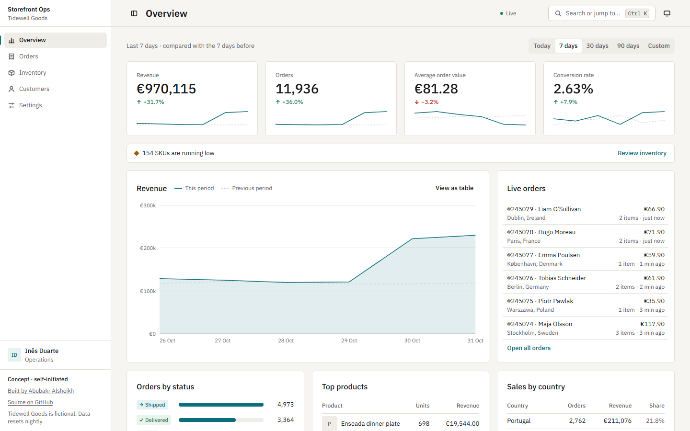
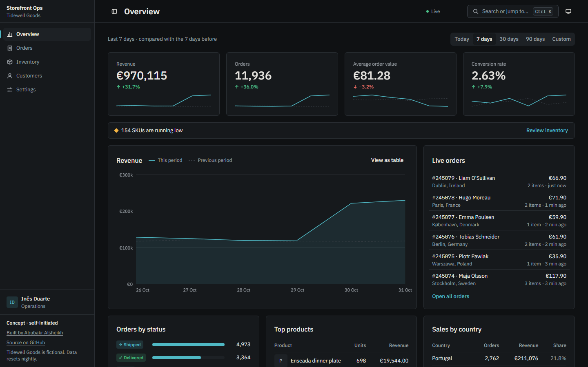
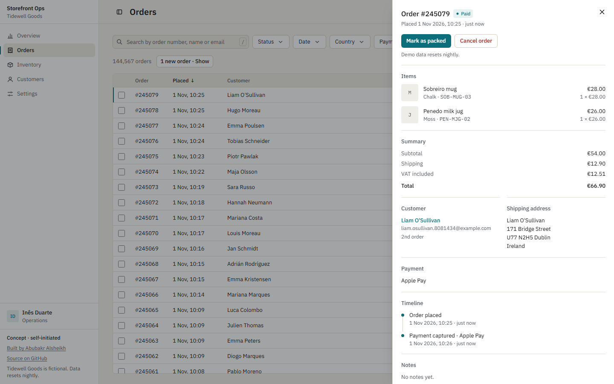
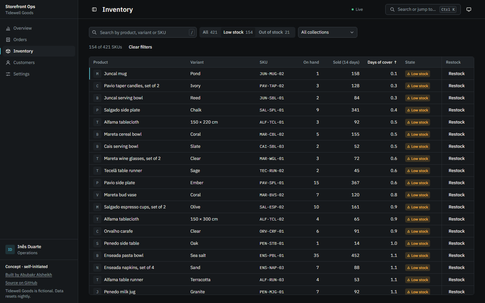
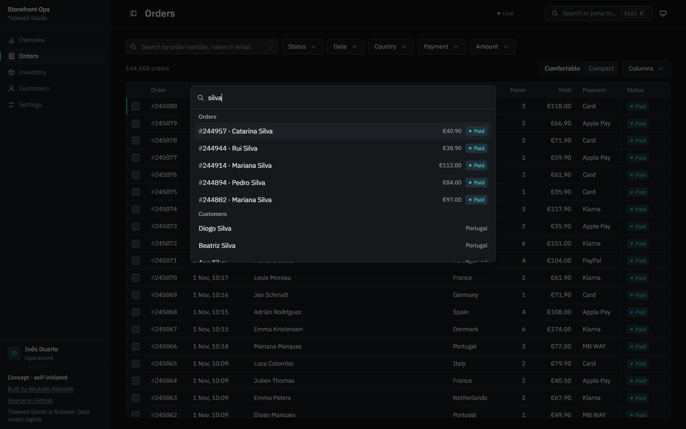
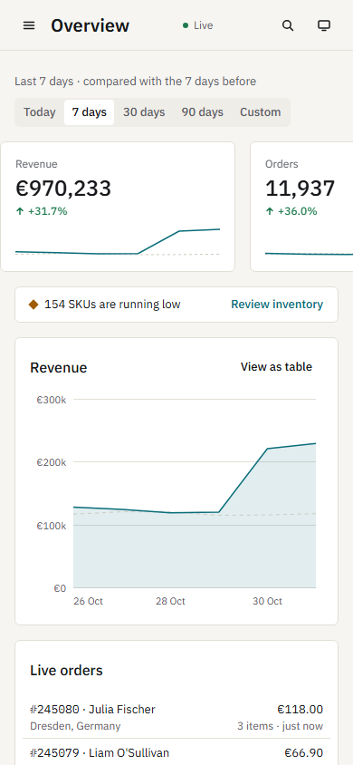

# Storefront Ops

**Concept · self-initiated**

Storefront Ops is the operations dashboard for Tidewell Goods, a fictional online homeware shop. It is a portfolio piece by [Abubakr Alsheikh](https://abubakr-alsheikh.netlify.app): the internal system a store team would open every morning.

**Live:** [storefront-ops.netlify.app](https://storefront-ops.netlify.app)



| | |
|---|---|
|  |  |
|  |  |



## What it does

- **Overview:** revenue, orders, average order value and conversion for a chosen range, each compared with the previous period. The revenue chart has a text summary for screen readers and a table view.
- **Live orders:** new orders arrive over server-sent events. The list slides, the KPIs update, and the table offers "N new orders · Show" instead of moving under your cursor.
- **Orders:** 90 days of history, about 144,000 rows, in one virtualised table. Filters, sort and search live in the URL, so a view can be shared.
- **Order panel:** line items, customer, payment, timeline and notes. Status changes apply at once and roll back if the server refuses.
- **Inventory:** stock, 14-day sales, days of cover, a state badge and a restock dialog.
- **Customers:** about 111,000 customers with segments and lifetime value, and a detail page with their order history.
- **Everywhere:** a command palette (Ctrl K), a shortcut sheet (`?`), keyboard control of every table, light and dark themes, and a phone layout.

## What is real and what is simulated

Tidewell Goods, its products, customers and orders are invented. Emails use `example.com`. A deterministic simulator generates the orders and sessions, and nothing on screen is typed into a component.

The code, the database, the queries, the live stream and the timings below are real. Anything a visitor changes stays visible to other visitors until a nightly job restores the seed.

## Run it locally

You need Node 24 and no accounts, keys or database:

```bash
npm ci
npm run dev
```

Open http://localhost:3000. The first request migrates and seeds an embedded Postgres ([PGlite](https://pglite.dev)) in `.pglite/`. From a fresh clone that first answer took 73 s and held 143,085 orders. Later starts are immediate.

To use a real Postgres, copy `.env.example` to `.env.local` and set `DATABASE_URL`.

```bash
npm run build         # production build
npm start             # serve it
npm run lint          # ESLint
npm run typecheck     # tsc --noEmit
npm test              # Vitest, on in-memory PGlite
npm run explain:hot   # the query table below, on a throwaway copy of .pglite/
```

## Architecture

```
Browser
  TanStack Query + typed Hono client  ── JSON ─────┐
  EventSource (one per tab)           ── SSE ──────┤
                                                   ▼
Next.js 16 route handler  /api/[[...route]]  →  Hono app  (src/server/)
                                                   │  Zod contracts, shared with the client
                                                   ▼
                                                Drizzle
                                       ┌───────────┴───────────┐
                              Neon over HTTP              PGlite (embedded)
                               (production)            (local and tests)
                                       ▲
Deterministic simulator (src/lib/sim/) ─┘  written in by the catch-up on reads and the stream,
                                           every 6 hours, and by the nightly reset
```

- The client imports only the `AppType` of the API, so a changed route breaks the client's type-check.
- The same UTC hour always produces the same orders on any machine. That lets the seed, the catch-up, the feed and the reset agree without coordination. A golden hash test guards it.
- Catch-up writes are single statements with `ON CONFLICT`, so two visitors arriving together cannot double-count an order.

## Decisions

### Windowed pagination, not cursors

The table's scrollbar stands for every matching row, so dragging it to the middle must land on the middle. Cursor pagination cannot jump there. Plain `OFFSET` can, but it gets slow far down the list. Three things make it fast:

1. **A deferred join.** The inner query walks an index for only the ids in the window, and the outer query then fetches those rows.
2. **Reading from the nearer end.** A page past the halfway point runs in the opposite direction and is reversed afterwards.
3. **Freezing the result.** The first page reports the newest order number, and later pages send it back as `upTo`. New orders cannot shift rows between pages until you click "N new orders · Show".

Only pages near the viewport load, and a dragged scrollbar waits until it slows down.

### Server-sent events on Netlify

Netlify functions cannot hold a WebSocket, so the feed uses SSE. Measured on the deployed site:

- Netlify does not buffer the stream: events arrive one at a time.
- Netlify ends a streamed response at 30 s, with no error and no final event.

So each stream ends itself after 25 s. Every stream opens with a `ready` event giving its position, and the client reopens from the last order it saw. EventSource's own reconnect is not used: it reports a clean end as an error, and it knows no position until the first order arrives. The stream closes while a tab is hidden, and three failures in a row fall back to polling every 10 s.

A KPI event is applied as a difference against the count already on screen, so applying one twice changes nothing.

### Less JavaScript

The first version of the charts used Recharts, and it pushed Total Blocking Time to 610 ms. The chart is now hand-drawn SVG. The live list's slide is one browser animation on the list, with no library. Dialogs and the palette load on first use.

### A fix for Netlify's free tier

Netlify adds a line break and a comment to `<head>` on free-tier production sites. React cannot match that whitespace, so it threw error #418 and rendered every page twice. An inline script in `src/app/layout.tsx` removes it before hydration. This never shows up locally.

## Measured

Taken 2026-11-01 unless noted.

**Lighthouse, deployed site.** Performance, three mobile runs and two desktop runs per route, with Netlify's Powered by Netlify badge on, which accounts for the layout shift below. Accessibility, best practices and SEO scored 100 on every run.

| Route | Mobile | Desktop | Mobile CLS | Mobile TBT |
|---|---:|---:|---:|---:|
| `/` | 90-95 | 95-96 | 0.003-0.004 | 140-230 ms |
| `/orders` | 92-98 | 94 | 0.004 | 80-250 ms |
| `/inventory` | 93-96 | 92-96 | 0.003-0.004 | 90-190 ms |

**Lighthouse, production build over a local HTTP/2 proxy.** Mobile, three runs per route, CLS 0: `/` 96-98, `/orders` 98, `/inventory` 98-99.

**axe:** 0 violations on the deployed `/`, `/orders`, `/inventory`, `/customers` and `/settings`, in both themes, at 360 and 1280.

**Orders table at 1280, local:** p95 frame 16.7 ms and 0 frames over 20 ms while wheel-scrolling. Under load from other work on the machine, some runs had up to 13 frames over 20 ms. About 29 rows are in the DOM.

**Tests:** 210 Vitest tests across 24 files. API routes run through Hono's typed test client on in-memory PGlite.

**Hot queries, `EXPLAIN ANALYZE`.** PGlite on about 144,000 orders, median of five warm runs of the statement the API sends. `npm run explain:hot` reproduces it.

| Query | Without indexes | With indexes | Plan with indexes |
|---|---:|---:|---|
| Default page (newest 200) | 186.5 ms | 1.9 ms | Index Only Scan `orders_placed_idx`, then `orders_pkey` |
| Deep page (`OFFSET 120000`) | 458.5 ms | 15.2 ms | Same, read from the far end |
| Status filter, page | 79.8 ms | 1.1 ms | Index Only Scan `orders_status_placed_idx` |
| Status filter, count | 52.8 ms | 1.4 ms | Index Only Scan `orders_open_idx` |
| Search "sil", page | 133.0 ms | 7.2 ms | Bitmap scan on trigram `orders_search_trgm_idx` |
| Search "sil", count | 105.2 ms | 4.6 ms | Same |

| Query | From raw tables | From a rollup |
|---|---:|---:|
| Overview 30 days, top products | 267.5 ms | 9.1 ms |
| Overview 30 days, sales by country | 49.9 ms | 0.5 ms |

On Neon, server-side execution measured 0.5 ms for the default page, 3.1 ms for the deep page, 0.6 ms for the status filter and 4.6 ms for search (2026-10-30). The unfiltered total reads a counter instead of running `count(*)`.

Requests take longer than those numbers. The deployed API reports about 100 ms per query, and a typical list takes 200-400 ms in total.

## Stack

- [Next.js 16](https://nextjs.org) (App Router, Cache Components), React 19, TypeScript (strict)
- [Hono](https://hono.dev) with a typed RPC client, [Zod](https://zod.dev) contracts
- [Drizzle ORM](https://orm.drizzle.team) on PostgreSQL: [Neon](https://neon.tech) in production, [PGlite](https://pglite.dev) locally and in tests
- [TanStack Query](https://tanstack.com/query), [Table](https://tanstack.com/table) and [Virtual](https://tanstack.com/virtual), [nuqs](https://nuqs.dev) for URL state
- [Radix](https://www.radix-ui.com) primitives, [cmdk](https://cmdk.paco.me), Tailwind CSS 4, IBM Plex Sans and Mono
- [Vitest](https://vitest.dev)
- Netlify: hosting, functions, a 6-hourly catch-up and a nightly reset

## Credits and licence

Product tiles show a neutral initial. The app uses no photographs, so there is nothing to credit.

Code: MIT.
